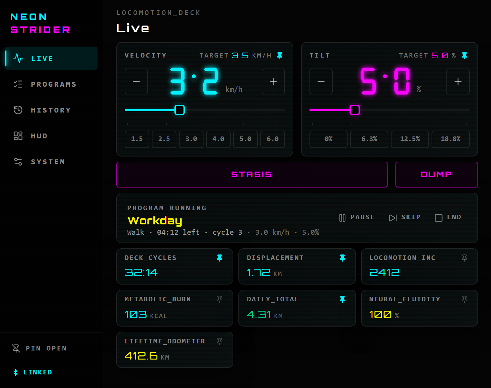
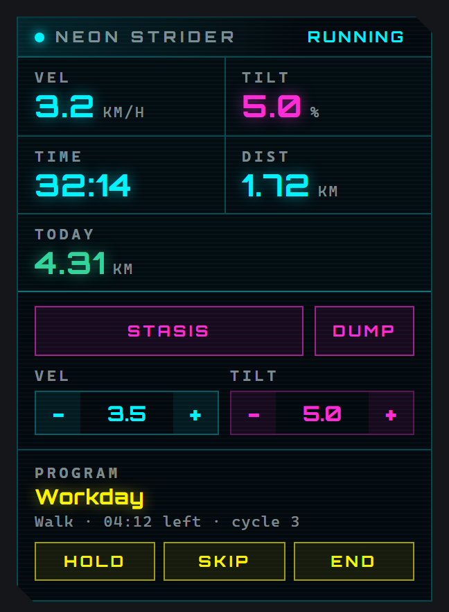
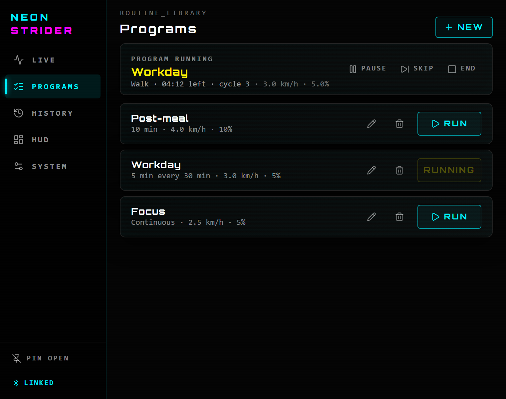
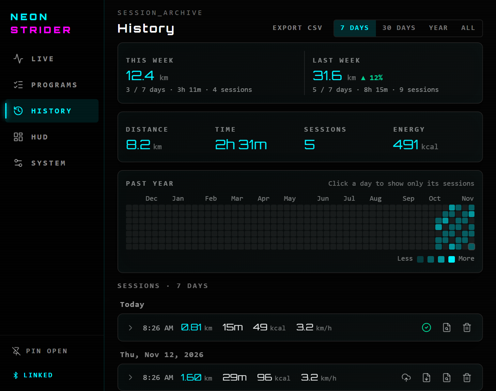
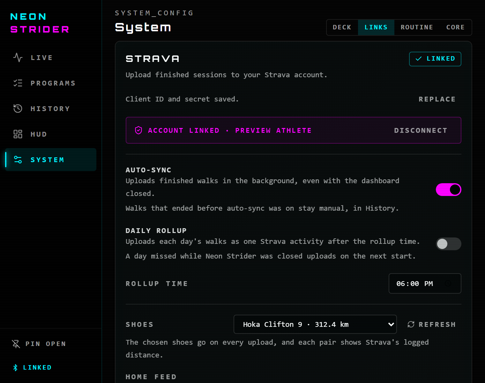
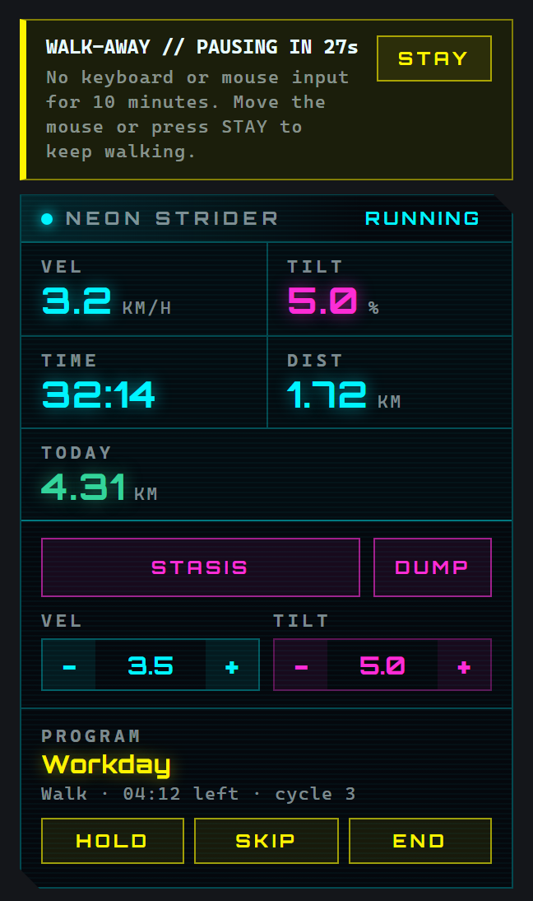
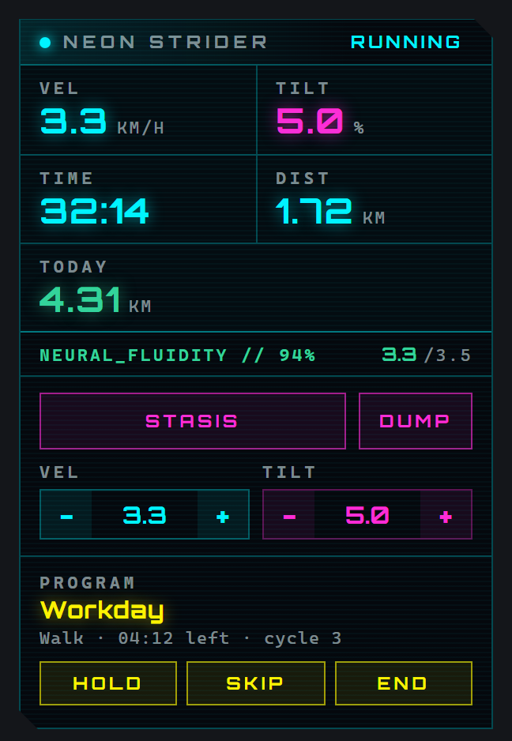

# Neon Strider

A Windows and Mac desktop controller for Bluetooth walking pads and treadmills that speak the
FitShow protocol. It lives in the system tray (the menu bar on a Mac), puts an always-on-top HUD in a corner of your
screen, runs saved walking programs, keeps your history, and uploads walks to Strava in the
background.

Windows 10 or 11, and macOS 13 or later (see [docs/macos.md](docs/macos.md) for the Mac).
Built and tested with a **Jogwell Ares 11 Elite** (FitShow protocol). Other
FitShow-based decks (the ones that advertise BLE service `FFF0`) should work, but haven't been
tried.

<p align="center">
  
  
</p>

## What it does

- **HUD overlay.** A small panel in the screen corner of your choice with live speed, incline,
  time and distance, start/pause/stop and speed/tilt steppers, and one-tap program buttons.
  Clicks pass straight through it except on the panel itself.
- **Dashboard.** Opens from the tray icon, with five pages:
  - **Live**: speed and tilt control, transport, the running program, session stats.
  - **Programs**: saved routines, e.g. *Post-meal* (10 min at 4.0 km/h, 5 %),
    *Workday* (5 min every 30 min, or 2 min every 20), *Focus* (2.0 km/h until you stop
    it), *Brisk* (30 min at 5.0 km/h), *VO2 max* (four 4-minute climbs at 6.0 km/h and
    10 %) or *Interval walk* (five rounds of 3 brisk minutes and 3 easy ones). Why each is built that way, with
    sources: [docs/research.md](docs/research.md). When a program ends, the
    treadmill goes back to what it was doing before; ended while the belt is paused, it stays
    paused, and Engage starts it at your earlier speed. A program never starts a still belt by
    itself: after each rest (or a 0 km/h step) the HUD shows `REST COMPLETE // PRESS GO` and
    waits for GO. Starting the belt with the treadmill's own buttons or remote counts as GO.
  - **History**: totals, a year calendar, every session with a speed/incline replay, Strava
    upload, and CSV export.
  - **HUD**: pick and order the HUD widgets and its corner.
  - **System**: treadmill limits, calibration, Strava, neural flow, desk nudges, belt
    maintenance, startup and diagnostics.
- **Strava.** Connect once; finished walks upload in the background, merged across short
  breaks, as indoor walks with your shoes, a themed title and description, and optional muting
  from your feed. Optional daily rollup uploads a day's walks as one activity after your shift
  ends.
- **Belt maintenance reminder.** Every 200 km or 3 months, editable (the sticker on
  the deck says 200 km / 125 miles; Jogwell's manual says 100 miles),
  or every so many belt hours if you prefer. It stays on the HUD until you mark the belt
  serviced. **System → Maintenance** also shows a lifetime odometer (distance, belt hours,
  since when), which you can pin to the HUD as ODO.
- **Idle nudge.** After 30 minutes (15 to 240) of keyboard and mouse use with the belt
  still, a HUD card (for example `32 MIN IDLE`) offers ENGAGE and up to three programs. The
  treadmill switches itself off when idle, so if it is off, the program you pick starts when
  it connects (within 15 minutes). SNOOZE 15 MIN brings it back in 15 minutes. Only the time
  of the last input is kept, never which keys. Turn it off in **System → Desk**.
- **Slow down on calls.** While an app is using the microphone (read from the list Windows
  keeps; nothing is recorded), a running belt eases to a quiet speed (default 2.0 km/h, never
  faster than it was) and goes back 10 seconds after the call ends, unless you changed the
  speed in the meantime. Also in **System → Desk**.
- **Keyboard shortcuts** that work from any app (see below).
- **Neural flow** (optional). While a program runs, it eases the belt speed down when you're
  busy at the keyboard and mouse. It counts activity only; it never records which keys you
  press.
- **Updates itself.** It checks GitHub when it starts and every hour, shows the release notes (every version you skipped included), and installs a signed update with one click.

## Screens

The dashboard pages and HUD cards, captured from the mocked preview (no treadmill or personal data).

| | |
|---|---|
|  |  |
|  |  |



## Install

Both come from the [GitHub Releases](../../releases) page, and update themselves once installed.

**Windows** (10 or 11, with Bluetooth LE):

1. Download `Neon Strider_<version>_x64-setup.exe`.
2. Run it. It installs for your user only, no admin prompt. The installer isn't code-signed,
   so Windows SmartScreen will warn: choose **More info**, then **Run anyway**.
3. Neon Strider starts as a tray icon. Left-click it for the dashboard; right-click to quit.
4. Optional: **System → Startup → Start with Windows**.

**Mac** (macOS 13 or later; Apple Silicon or Intel):

1. Download `Neon Strider_<version>_universal.dmg`, open it and drag Neon Strider to
   Applications.
2. Open it. It isn't notarized yet, so the first time macOS won't: open **System Settings →
   Privacy & Security** and choose **Open Anyway** (on macOS 14 and earlier, right-click the app
   and choose **Open** also works).
3. Neon Strider lives in the menu bar: click its icon for the dashboard. macOS asks for Bluetooth
   the first time it scans.
4. Optional: **System → Startup → Launch at login**.

## First run

1. **Connect.** Click the Bluetooth link at the bottom of the dashboard's left rail, scan,
   and pick your treadmill. It reconnects by itself after that.
2. **Set limits.** In **System → Treadmill**, check top speed, highest incline level and how
   many percent of grade each incline step is.
3. **Calibrate** (optional). **System → Calibration** corrects the deck's distance and speed
   so they match what you actually walk. It starts empty, so the deck's own numbers are used
   until you add points.
4. **Maintenance.** In **System → Maintenance**, enter the date you last lubricated the belt.

### Strava

Strava requires every app to use its own API credentials, so you create your own Strava API
app (it's free and takes a minute):

1. Create an application at <https://www.strava.com/settings/api>. Any name and website
   will do; set **Authorization Callback Domain** to `localhost`.
2. In **System → Strava**, paste the Client ID and Client Secret, then **Connect** and
   approve in the browser window that opens.
3. Turn on **Auto-sync**. Only walks that finish after you turn it on upload automatically;
   older ones can be uploaded from History.
4. Optional, in the same section: choose your **shoes**, whether walks are **muted** from your
   home feed (all, only short ones, or none), and edit the **title and description
   templates**. Uploads are marked as indoor walks, and a walk another app already put on
   Strava is skipped rather than duplicated.

Connecting asks for permission to upload, to read your recent activities (the duplicate
check) and your profile (the shoe list). If you connected before these existed, disconnect and
connect again.

The client secret and your Strava login are kept in Windows Credential Manager, not in the
app's database.

## Keyboard shortcuts

The defaults; change any of them in **System → Shortcuts** (record a new key, remove one, or
switch a shortcut off). Each needs Ctrl, Alt or the Windows key.

| Keys | Action |
| --- | --- |
| Alt + Volume Up, or Alt + `=` | Speed up |
| Alt + Volume Down, or Alt + `-` | Speed down |
| Alt + Page Up | Incline up |
| Alt + Page Down | Incline down |
| Alt + Home | Start / pause (GO on a paused program) |
| Alt + End | End the running program, or rerun the last one |
| Alt + Insert | Shrink the HUD to a strip, or show the whole HUD again |
| Alt + Space | GROUND_TRUTH tap, while a tap run listens |

On a Mac the shortcuts are ⌃⌥ plus a key; see [docs/macos.md](docs/macos.md).

## Your data

Everything stays on your computer unless you connect Strava.

- **History and settings:** `%APPDATA%\com.freshbreweddesign.neonstrider\treadmill.db` (SQLite);
  on a Mac, `~/Library/Application Support/com.freshbreweddesign.neonstrider/treadmill.db`.
- **Strava secret and login:** Windows Credential Manager (the Keychain on a Mac), under
  `com.freshbreweddesign.neonstrider`.
- **Backups:** `%APPDATA%\com.freshbreweddesign.neonstrider\backups\`. One copy a day, the newest 14
  kept, plus a copy taken before any database upgrade.
- **Logs:** **System → Diagnostics → Open log folder**. No secrets or keystrokes are logged.
- **CSV export:** **History → Export CSV** writes every session to your Downloads folder.

## Privacy

- Key presses are counted, never recorded. Neural flow and the idle nudge only know
  how much you typed or when you last used the keyboard or mouse, never which keys.
- The Strava client secret and login live in Windows Credential Manager, not in the database.
- Everything else (history, settings, backups, logs) stays on your PC. The only data that
  leaves it is what you upload to Strava yourself. To find updates, the app asks GitHub for
  this project's public release list; it sends nothing about you or your walks.

## Building from source

Requirements: Node 20+, Rust stable, and the [Tauri 2 prerequisites](https://tauri.app/start/prerequisites/)
for Windows (or macOS: see [docs/macos.md](docs/macos.md)).

```bash
npm install
npm run tauri dev     # full app with hot reload
npm run tauri build   # NSIS installer in src-tauri/target/release/bundle/nsis/
```

Checks, all expected to pass clean:

```bash
npx tsc --noEmit
npx eslint .
npx vitest run
npx vite build
cd src-tauri
cargo test                   # also regenerates the TypeScript IPC types
cargo fmt --check
cargo clippy --all-targets -- -D warnings
```

You can work on the UI without a treadmill: run `npm run dev` and open
`/dashboard-preview.html` or `/hud-preview.html`. Both use a mocked backend; URL flags such as
`?idle`, `?offline`, `?due` and `?anchor=top_left` switch scenarios.

### How it fits together

The Rust side owns everything that matters: the Bluetooth link and FitShow protocol,
calibration, sessions, programs, Strava and the maintenance counter. It publishes one
`AppSnapshot` to the windows several times a second and takes one typed `Command` back.
The dashboard and HUD are views of that snapshot, so they never need to talk to each other
and neither has to be open for anything to work.

- `src-tauri/src/`: engine, Bluetooth, programs, Strava (`strava/`), persistence, and the snapshot
  and commands (`snapshot/`)
- `src-tauri/src/platform/`: the only place with OS-specific code (Windows today)
- `src/dashboard/`: the dashboard window, its pages and their pieces
- `src/hud/`: the HUD overlay (its own small bundle)
- `src/ipc/bindings/`: TypeScript types generated from Rust by ts-rs

`CLAUDE.md` has the architecture details. The reverse-engineered protocol notes are in
[docs/protocol.md](docs/protocol.md).

## Contributing

See [CONTRIBUTING.md](CONTRIBUTING.md) for the checks, UI rules and release-note convention.
More documentation is in [docs/](docs/). To report a security problem, see
[SECURITY.md](SECURITY.md).

## License

[MIT](LICENSE), Copyright (c) 2026 Fresh Brewed Design.

## Disclaimer

Neon Strider is an independent project, not affiliated with or endorsed by Strava, FitShow or Jogwell. Product names are trademarks of their owners.

## Credits

- [Orbitron](https://fonts.google.com/specimen/Orbitron) font, SIL OFL 1.1, bundled via `@fontsource/orbitron`
- [Lucide](https://lucide.dev) icons, ISC
